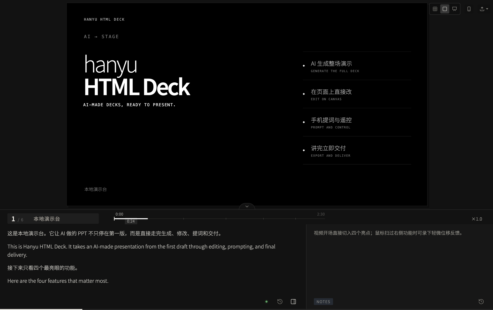
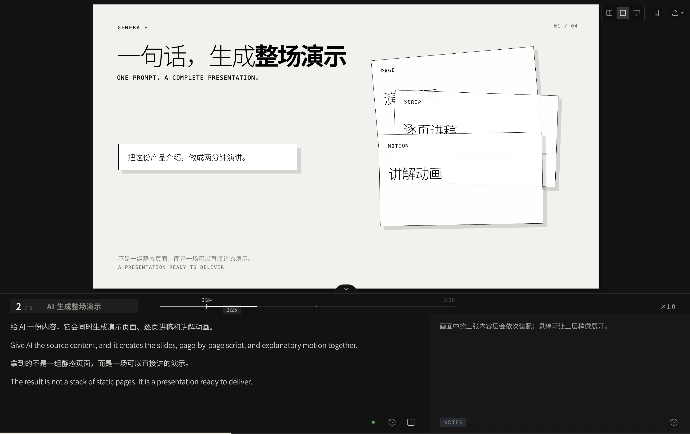
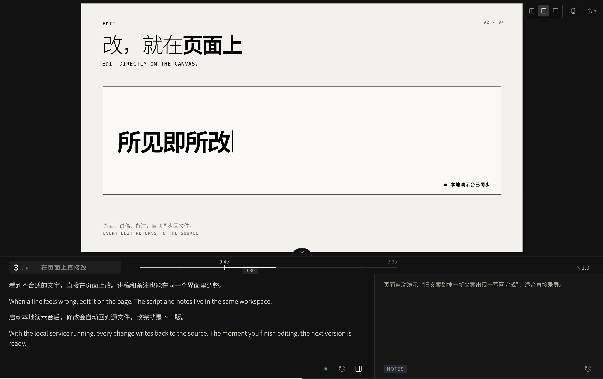
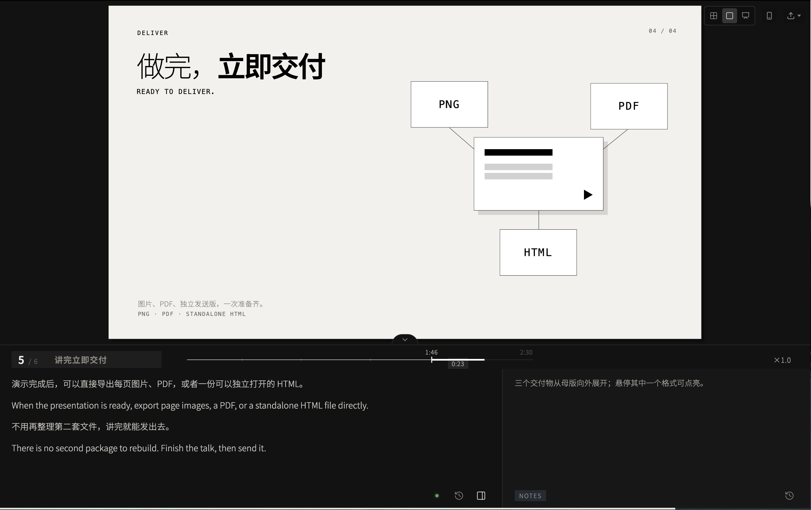
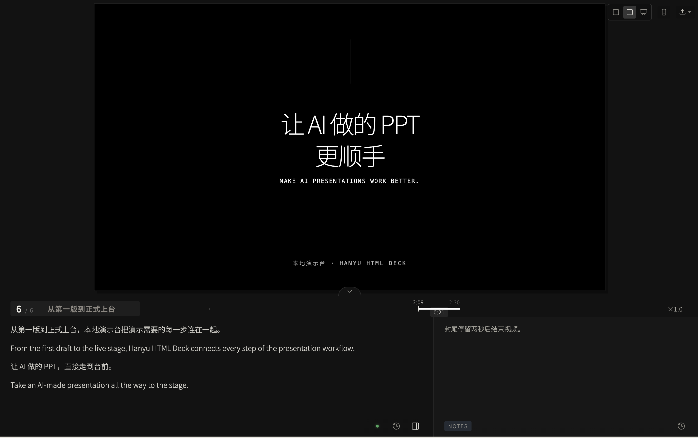
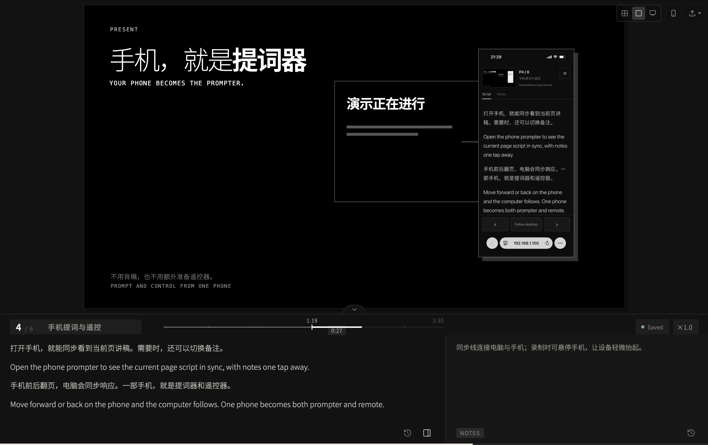

# Hanyu HTML Deck

[中文](README.md) · [English](README.en.md)

A local-first framework for AI-generated HTML presentations. The Chinese name is 本地演示台 — "the local presentation stand".

Hanyu HTML Deck ships as both a reusable presentation template and a focused skill. The core HTML needs no install, account, or network connection. A local service adds phone prompting, remote control, source write-back, and exports.

## What it is

Hanyu HTML Deck gives you presentation mechanics and an authoring workflow: navigation, step animations, speaker script, notes, phone prompting, source write-back, and exports.

It is not a slide design template. There are no themes, color schemes, or ready-made layout sets. `assets/hanyu-html-deck/index.html` is a runnable starting point, and its sample pages are page skeletons — the actual layout is built for each deck from its own content. If what you want is a theme or layout pack, this project does not solve that.

## Interface preview

<table>
  <tr>
    <td width="50%" align="center"><br><sub>Complete workspace · 完整演示台</sub></td>
    <td width="50%" align="center"><br><sub>Full-deck generation · AI 生成整场演示</sub></td>
  </tr>
  <tr>
    <td width="50%" align="center"><br><sub>Direct canvas editing · 在页面上直接修改</sub></td>
    <td width="50%" align="center"><br><sub>Export-ready delivery · 导出与交付</sub></td>
  </tr>
  <tr>
    <td width="50%" align="center"><br><sub>Closing slide · 演示封尾</sub></td>
    <td width="50%" align="center"><br><sub>Phone prompt &amp; control · 手机提词与遥控</sub></td>
  </tr>
</table>

## Intended use

- Building HTML presentations with AI coding tools such as Codex or Claude Code.
- Keeping slides, speaker script, and revision notes in one file.
- Using a phone as a teleprompter and remote without depending on public infrastructure.
- Writing browser edits back to the original HTML with explicit safety checks.

## Feature boundary

| Feature | HTML only | Local service |
|---|:---:|:---:|
| Navigation, authoring outline, chapter timeline, overview, presentation mode | ✓ | ✓ |
| Archive, browse, and restore slides from overview | ✓ | ✓ |
| Step animations and hover interactions | ✓ | ✓ |
| Edit script and notes in the browser | ✓ | ✓ |
| Remember panel and drawer state | ✓ | ✓ |
| Export script | ✓ | ✓ |
| Phone teleprompter and remote | | ✓ |
| Write scripts and notes to the collaborative content store, and canvas text back to source | | ✓ |
| Export page images, PDF, and a standalone send copy | | ✓ |

The local service stays on the current LAN. It does not use a public relay or upload speaker content. Cross-network control is intentionally out of scope.

## Quick start

Copy this command into your AI coding tool:

```text
Read https://github.com/42MilesZ/hanyu-html-deck and use its Hanyu HTML Deck Skill to turn [content or file] into a [page count]-page HTML presentation for [audience / occasion], saved to [target directory]. Make important information and every page script bilingual in Chinese and English.
```

Or create one manually:

```bash
git clone https://github.com/42MilesZ/hanyu-html-deck.git
cd hanyu-html-deck
python3 scripts/create_deck.py ~/Documents/my-deck
```

Open `my-deck/启动本地演示台.command`: it starts the local service and, once the service is ready, opens the deck. Update `DECK.name` and `DECK.key` near the end of `index.html`, then replace the six sample pages. Give each page a stable `data-slide-id`, a chapter in `data-part`, and a short outline label in `data-outline`. Double-clicking `index.html` directly also works for offline viewing, but it will not write back.

The core HTML works in modern browsers on macOS, Windows, and Linux. The local service, launcher, and export workflow are currently verified on macOS only: image, PDF, and send-copy exports rely on the macOS `sips` command. On Windows and Linux, run `python3 scripts/prompter_server.py` to use phone prompting and write-back; the exports are unavailable.

## Installing the skill

The skill lets an AI coding tool build decks against this project's conventions.

- As an installed skill: place the repository (keeping `assets/` and `scripts/`) in the directory your tool reads skills from, for example `~/.claude/skills/hanyu-html-deck/`. The relative paths inside `SKILL.md` depend on that layout.
- Without installing: point the AI at `SKILL.md` in the repository and name your target directory.

When invoking it, state the content, the occasion, and the page count, and ask explicitly for the Hanyu HTML Deck skill.

### Combining it with PPT / slides skills

Hanyu HTML Deck can work with an existing PPT, slides, presentation-structure, or visual-design skill. Those skills decide what to say, how to pace it, and what each page should look like; Hanyu HTML Deck puts the result into an HTML runtime with presenting, prompting, write-back, and export.

A typical sequence is:

1. A PPT / slides skill defines the story, page order, and conclusion of each page.
2. A visual-design skill defines the visual subject, layout, and motion.
3. Hanyu HTML Deck uses `assets/hanyu-html-deck/index.html` to implement the pages, bilingual script, and interactions.

You can also package this sequence into one primary skill. Let its `SKILL.md` route the content, visual, and runtime stages while referencing the existing rules and assets. The Hanyu template remains the final runtime, so one skill invocation is enough without maintaining duplicate presentation engines.

Example:

> Use my slides content rules to build a six-page structure, apply the visual-design rules, then produce a presentation-ready HTML with Hanyu HTML Deck. Keep tool UI in English, and make important content and every page script bilingual in Chinese and English.

### Language convention

- Non-content deck text defaults to English: toolbar controls, speed units such as `min` and `chars/min`, hover explanations, export controls, and status messages.
- Slide content follows the primary audience language. Important titles, conclusions, data, and key selling points are bilingual, with short scannable English set at weight `200`; an English brand or product name used as the primary visual may use `600`.
- Every page script is bilingual. Keep the Chinese and corresponding English in separate paragraphs and deliver them in sequence; the duration estimate counts both languages.

## Script and notes

The bottom script panel starts collapsed to a single header row. Press `N` to expand it. Speaker scripts are plain paragraphs with no required outline structure.

Once expanded, a sidebar icon at the bottom right of the script column opens the notes drawer, and closes it again. Drag the drawer's left edge to resize the notes column; the width is remembered. Notes can hold revision requests, supporting information, or personal reminders. Closing the drawer only changes the view; it does not delete content.

`deck-content.json` is the collaborative source of truth for scripts and notes; `.ns/.nc` in the HTML are offline seeds. Browser drafts, caches, and histories are keyed by stable slide ID. Field writes use revisions and short leases so a browser and an AI tool do not silently overwrite one another.

The left outline is generated from each slide's `data-part` and `data-outline` and appears only in the default authoring view. The bottom timeline groups pages by chapter, preserves a usable minimum hit area for short pages, and degrades to equal widths when space is tight. Changing speaking speed updates time labels without changing the timeline geometry.

The export menu includes:

- `Export script`: downloads all speaker scripts as Markdown.
- `Export page images`: renders one PNG per page; needs the local service and Playwright.
- `Export PDF`: captures every page, then assembles an image-based PDF.
- `Export standalone HTML`: one self-contained HTML file with fonts and images inlined, notes and write-back code stripped.
- `Use 1:1 pixels`: disables canvas scaling so DOM or Figma capture tools see true 1920 × 1080 coordinates.

Hovering a menu item for about 0.2 seconds shows a one-line explanation.

## Phone teleprompter

Start the local service, then click the phone icon in the deck. Scan the LAN QR code. The QR refreshes automatically if the network address changes.

Opening the phone prompter prepares current page thumbnails and step frames in the background. Direct canvas edits and archive changes then rebuild and refresh the phone preview automatically. Preview images require Playwright; without it, scripts, notes, and remote control continue to work without page images.

Use the same trusted Wi-Fi by default. If no suitable Wi-Fi is available, enable the phone hotspot and connect the computer to it.

The phone starts on the speaker script. A `Script / Notes` control switches views, and each page/view keeps its own scroll position. The phone can follow the computer or browse independently.

For a formal presentation, test the connection 5–10 minutes early, move forward and back two pages, disable VPNs, prevent auto-lock, and keep the phone powered.

## Local service dependencies

Phone prompting, remote control, and source write-back need Python 3 only. The QR generator is vendored.

Image and PDF exports, along with the repository's real-browser behavior tests, additionally require:

```bash
python3 -m pip install playwright
python3 -m playwright install chromium
```

The single-file HTML export does not require Playwright. It embeds fonts and images and removes notes and source write-back code.

## Source write-back

- Script and note edits are saved in the browser immediately. While the local service is running, they write to `deck-content.json` automatically 3 seconds after you stop typing. There is no save button.
- With the service stopped, the deck does not write back: edits live in the browser (they survive a reload), and the save status says why. Start the service and change any character to flush the pending edits.
- Why a credential: any web page in your browser can present itself as a local file (`Origin: null`) and post to a service on your machine, so "came from this machine" is not a sufficient check. On startup the service stamps a one-time credential into `index.html` and clears it on exit; write-back, exports, and phone prompting all require it, and other pages cannot obtain it.
- So the page has to be opened after the service starts. If it was already open, the save status tells you to reload. The launcher waits for the service to answer before opening the deck.
- One shared save status sits in the panel header: `Saved` means both script and notes are on disk; `Saving…` means edits are safe in the browser and waiting to write back; a disconnected session shows `Offline` or `Reconnect`; and a rejected write-back shows `Error` with the server reason. Hover it to list the pending pages and content types.
- Clearing a script or note completely is still written back. Pasted content is sanitized before write-back so browser-added font, color, and style attributes cannot leave the deck stuck pending; text, paragraphs, lists, and basic emphasis are preserved.
- Script and notes each have their own history button and version timeline, with any snapshot or the original text available to restore.
- Double-click canvas text to edit it; blur writes the updated canvas back.
- Write-back accepts only local requests carrying the credential. Before replacing the file the service checks the page count and structure, validates the markup against a tag/attribute allowlist using an HTML tokenizer, and swaps the file atomically.

## Keyboard

- `← / →`: previous page / next page; in-page states advance automatically after entry
- `P` or `F`: presentation mode
- `O`: overview
- `N`: expand or collapse the script panel
- `R`: 1:1 pixel view
- `Esc`: leave the current mode

## Slide archive

In overview (`O`), every thumbnail has an archive action. Archived slides stay in the source file but are excluded from navigation, numbering, the timeline, phone prompting, and exports. The archive box in the upper-right lets you browse and restore them, and each action can be undone. At least one current slide is always kept.

Offline changes are stored in the browser; with the local service running, the state is written safely back to `index.html`. A stale browser cache will not overwrite a newer source state from another session. When the phone prompter is enabled, archive changes rebuild its previews automatically.

## Repository files

`scripts/create_deck.py` copies only the runnable template, fonts, local service, and the `LICENSE` that must accompany copies of the software, then initializes `deck-content.json` from the HTML seeds. It excludes maintenance contracts, repository documentation, runtime state, and export intermediates. Repository-only material stays under `support/`:

- `support/tests/` checks page-to-note alignment, separate UI state, local-network boundaries, and agreed product labels.
- `support/evals/` checks whether an AI agent follows the Skill when creating a Deck.
- `support/THIRD_PARTY_NOTICES.md` summarizes the bundled font and QR-generator licenses; the font and vendored QR directories retain their original license files.
- `.github/workflows/ci.yml` runs the tests after each push.

## License

Original code, templates, and the skill use the [MIT License](LICENSE). See the [third-party notices](support/THIRD_PARTY_NOTICES.md) for bundled font and QR-generator licenses.
